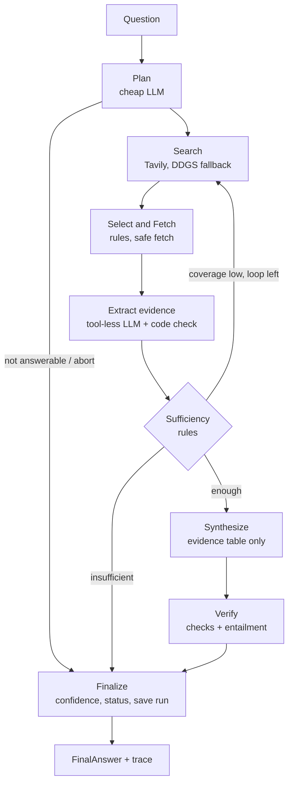

# Research Agent

**A bounded, evidence-first AI research agent with a traceable pipeline**

Plan a research question, search the web, fetch pages safely, extract passages that code verifies are really on the page, and return a structured answer with sources, confidence, limitations and next steps.

  

## At a glance

| | |
|---|---|
| **Input** | A natural-language research question |
| **Workflow** | Plan, Search, Select and Fetch, Extract, Sufficiency, Synthesize, Verify, Finalize |
| **Tools** | Tavily search, DDGS search (fallback), safe page fetch |
| **LLM** | Groq (OpenAI-compatible API), `gpt-oss` models |
| **Output** | Question, short answer, key findings, sources, confidence, limitations, next steps |
| **Visibility** | Per-node trace (time, tokens, tool calls, retries, failures), saved run JSON |
| **Safety** | Tool-less evidence extractor, URL allowlist, SSRF checks, injection scan, budgets |
| **Interface** | Command-line tool (`main.py`) |

> **Prototype status:** The workflow, tools, safety controls, structured output, trace, tests and a small evaluation are implemented. The project does **not** claim guaranteed factual accuracy. See [Known limitations](#19-known-limitations-and-future-improvements).

## Table of contents

1. [Overview](#1-overview)
2. [Problem statement](#2-problem-statement)
3. [Key features](#3-key-features)
4. [Demo link](#4-demo-link)
5. [Technology stack](#5-technology-stack)
6. [System architecture](#6-system-architecture)
7. [Project workflow](#7-project-workflow)
8. [Directory structure](#8-directory-structure)
9. [Prerequisites](#9-prerequisites)
10. [Installation and setup](#10-installation-and-setup)
11. [Environment variables](#11-environment-variables)
12. [Running the project](#12-running-the-project)
13. [Internal interfaces](#13-internal-interfaces)
14. [Data storage](#14-data-storage)
15. [Methodology and core algorithms](#15-methodology-and-core-algorithms)
16. [Testing and evaluation](#16-testing-and-evaluation)
17. [Security and privacy](#17-security-and-privacy)
18. [Troubleshooting](#18-troubleshooting)
19. [Known limitations and future improvements](#19-known-limitations-and-future-improvements)
20. [Assignment requirement mapping](#20-assignment-requirement-mapping)
21. [Assignment questions and sample outputs](#21-assignment-questions-and-sample-outputs)

---

## 1. Overview

### Purpose

The agent is built for research-style questions that need more than one model completion, for example:

- Compare the top 3 open-source vector databases for a startup building RAG products.
- Research the pros and cons of a multi-agent architecture for customer support automation.
- Compare different approaches to adding memory in an AI support agent.
- Find 5 Indian B2B SaaS startups in HR tech and summarize their positioning.

### Design philosophy

> Use the LLM for flexible reasoning and writing. Use deterministic Python for flow control, budgets, retries, URL safety, evidence verification and confidence.

The model never chooses which URL to fetch and never runs tools on its own. Code decides what is allowed, how far to go, and when to stop.

---

## 2. Problem statement

A fluent model answer is not the same as a researched, verifiable answer. Common failure modes include unsupported claims, invented quotes, stale or low-quality sources, incomplete multi-part answers, hidden tool activity, poor behavior when a tool fails, and obeying instructions planted in web pages.

This project separates the task into explicit stages so each stage can be checked, limited and traced. The goal is not to guarantee truth. The goal is an answer that is **traceable, evidence-aware, failure-tolerant and honest about uncertainty**.

---

## 3. Key features

**Structured planning.** The planner restates the question, decides whether it is answerable, and creates sub-questions with keyword queries and a strategy (`search_only` or `search_and_fetch`). Nonsense input is rejected before any search. If the model keeps returning invalid plans, a deterministic fallback plan is used (`PLAN_FALLBACK`).

**Real tools, bounded use.**
- Search through Tavily, with DDGS as a fallback provider.
- Page fetch with `httpx` and `trafilatura`, with size, redirect and timeout limits.
- A fault-injection wrapper to simulate timeouts and errors for testing.

**Evidence table with code-checked passages.** A tool-less LLM copies short passages from pages. Code checks each passage is a normalized substring of the fetched source and drops anything that is not.

**Evidence-only synthesis.** The answer writer sees only the evidence table (ids, passages, claims), never raw pages. Every finding cites evidence ids.

**Verification.** Dangling citations are dropped, numbers and years must appear in cited passages, and one batched entailment check labels findings supported, partial or unsupported.

**Rule-based confidence.** Confidence is computed by code from coverage, independent domains, source quality, conflicts, snippet-only share and verification status. It is not the model's own feeling.

**Failure-aware behavior.** Terminal states are `DONE`, `DEGRADED` and `FAILED_GRACEFULLY`. Operational failures never crash a run.

**Observability.** A per-node trace (time, tokens, tool calls, retries, failures) and a saved JSON run for every question.

**Dev-only file cache.** An optional record/replay cache saves quota during development. It is disabled for evaluation timings (`USE_CACHE=false`).

---

## 4. Demo link

**Demo video:** TODO(verify): add the link after recording.

The 3 to 5 minute demo shows:

1. A successful research question with plan, sources, findings and confidence.
2. A finding traced back to its source passage.
3. A search-failure case with retries and degraded status.
4. A nonsense query that stops without searching.
5. The offline prompt-injection tests passing.

---

## 5. Technology stack

| Technology | Role | Why |
|---|---|---|
| Python 3.11+ | Language | Strong ecosystem for AI, networking, validation and testing |
| Groq API via the `openai` SDK | LLM provider | Fast hosted inference, OpenAI-compatible interface |
| `openai/gpt-oss-20b`, `openai/gpt-oss-120b` | Cheap and strong model roles | Open-weight models with a free tier on Groq |
| Tavily | Primary search | Scored results with dates through one API |
| ddgs | Fallback search | Free provider used when Tavily fails |
| httpx | HTTP client | Explicit timeouts, streaming, manual redirect control |
| trafilatura | Page extraction | Extracts readable main text from HTML |
| tldextract | Domain parsing | Registered domain for dedupe and independence counts |
| Pydantic v2 | Data contracts | Typed validation for plans, evidence, findings and answers |
| rich | Terminal output | Readable rendering of the final answer |
| pytest, respx, ruff | Quality | Offline tests with fakes, HTTP mocking, linting |
| python-dotenv | Configuration | Loads local settings without putting secrets in code |

### Why a plain Python orchestrator instead of LangGraph?

The flow is a short, mostly linear pipeline with one bounded loop. A single readable function makes budgets, retries and security easier to audit than a graph framework. A framework would become useful with many branches, parallel tools, human approval, persistence or resumable runs.

---

## 6. System architecture



### Responsibility boundaries

| Component | Responsibility |
|---|---|
| `main.py` | CLI: flags, rendering, exit codes |
| `pipeline.py` | Sequencing, routing, node wrapper, graceful failure |
| `schemas.py` | Typed contracts (plan, evidence, findings, final answer) |
| `config.py` | Settings and execution limits from environment |
| `guard.py` | Argument validation, retry with backoff, memo, error classes |
| `budget.py`, `tracing.py` | Budgets and JSONL tracing |
| `llm.py`, `cache.py` | Groq client, retry and correction loop, dev cache |
| `filters.py` | URL normalization, dedupe, scoring, injection scan |
| `nodes/` | One module per pipeline stage |
| `tools/` | Search providers, safe fetch, URL safety, fault injection |
| `render.py` | Fixed-order terminal output |

---

## 7. Project workflow

1. **Plan.** Restate the question, decide whether it is answerable, create sub-questions with queries and strategy. Invalid output is sent back to the model for correction a bounded number of times, then a deterministic plan is used.
2. **Search.** Run each query through the provider chain (Tavily, then DDGS) with validation, backoff and fallback.
3. **Select and fetch.** Normalize and dedupe URLs, score sources, fetch the top pages, and fall back to a search snippet when a fetch fails.
4. **Extract evidence.** The tool-less LLM proposes short passages. Code keeps only passages that are verbatim in the source and within length limits.
5. **Sufficiency.** Rules compute coverage and route to synthesize, refine (one extra search round) or insufficient.
6. **Synthesize.** The strong model writes findings from the evidence table only.
7. **Verify.** Unknown evidence ids are dropped, numbers are checked against cited passages, and a batched entailment check labels each finding.
8. **Finalize.** Code computes status, confidence and auto-generated limitations, builds sources used, and saves `runs/<run_id>.json`.

### Failure handling at a glance

| Situation | Behavior |
|---|---|
| Timeout, 429, 5xx | Backoff and retry (bounded), then next provider |
| 403, 404, paywall | Fail fast, skip page, use snippet if long enough |
| Invalid tool arguments | Validation error sent back for bounded correction |
| Invalid LLM output | JSON-mode retry, correction loop, then deterministic fallback or graceful failure |
| Passage not found on page | Evidence dropped |
| Sources disagree | Shown in `conflicts` |
| Not enough evidence | "Reliable information not found", LOW confidence, no guessing |
| Budget exceeded | Stop, return degraded answer |

---

## 8. Directory structure


```
research-agent/
├── main.py                      # CLI entry point
├── pyproject.toml
├── .env.example
├── AGENTS.md
├── README.md
├── EVALUATION.md
├── docs/
│   └── SPEC.md                  # design specification
├── src/research_agent/
│   ├── __init__.py
│   ├── budget.py
│   ├── cache.py
│   ├── config.py
│   ├── deps.py
│   ├── errors.py
│   ├── filters.py
│   ├── guard.py
│   ├── llm.py
│   ├── pipeline.py
│   ├── render.py
│   ├── schemas.py
│   ├── tracing.py
│   ├── nodes/
│   │   ├── extract.py
│   │   ├── finalize.py
│   │   ├── plan.py
│   │   ├── search.py
│   │   ├── select_fetch.py
│   │   ├── sufficiency.py
│   │   ├── synthesize.py
│   │   └── verify.py
│   ├── prompts/
│   │   ├── extract.py
│   │   ├── plan.py
│   │   ├── refine.py
│   │   ├── synthesize.py
│   │   └── verify.py
│   └── tools/
│       ├── base.py
│       ├── ddgs_search.py
│       ├── faults.py
│       ├── fetch_page.py
│       ├── tavily_search.py
│       └── url_safety.py
├── evals/                       # test queries, fixtures, results.json, results.md
├── samples/                     # saved sample outputs (JSON)
├── scripts/                     # smoke_llm.py, run_eval_lite.py, diag_dns.py,
│                                # review_sheet.py
├── tests/                       # offline tests using fake LLM and fake tools
├── logs/                        # per-run JSONL traces (generated)
├── runs/                        # per-run answers (generated)
└── cache/                       # dev-only cache (generated, git-ignored)
```

---

## 9. Prerequisites

- Python 3.11 or newer (`requires-python = ">=3.11"` in `pyproject.toml`)
- Internet access for search and page retrieval
- A Tavily API key (free tier available)
- A Groq API key (free tier available)
- Windows PowerShell commands are shown; they translate directly to other shells

---

## 10. Installation and setup

```powershell
# 1. Create and activate a virtual environment
python -m venv .venv
.\.venv\Scripts\Activate.ps1

# 2. Install the project in editable mode with dev tools
pip install -e ".[dev]"

# 3. Create your local settings file (never commit it)
Copy-Item .env.example .env
```

Edit `.env` and set at least:

```dotenv
TAVILY_API_KEY=your_tavily_key
LLM_PROVIDER=groq
LLM_API_KEY=your_groq_key
LLM_MODEL_CHEAP=openai/gpt-oss-20b
LLM_MODEL_STRONG=openai/gpt-oss-120b
```

Verify the setup:

```powershell
python -c "import research_agent; print('ok')"
pytest -q
ruff check .
```

> If you see `ModuleNotFoundError`, you are probably using the system Python instead of the virtual environment. The prompt should start with `(.venv)`.

---

## 11. Environment variables

Settings are read from `.env` or the environment. Any settings field can be overridden by its uppercase name.

| Variable | Purpose | Notes |
|---|---|---|
| `TAVILY_API_KEY` | Tavily search key | Required for the default search chain |
| `LLM_PROVIDER` | LLM backend | Only `groq` is implemented |
| `LLM_API_KEY` | Groq key | Required for live runs |
| `LLM_MODEL_CHEAP` | Model for plan, extract, refine, verify | Default `openai/gpt-oss-20b` |
| `LLM_MODEL_STRONG` | Model for synthesis | Default `openai/gpt-oss-120b` |
| `SEARCH_PROVIDERS` | Provider order | Default `tavily,ddgs` |
| `MAX_SUBQUESTIONS` | Max sub-questions | Count fields must be at least 1 |
| `MAX_SEARCHES`, `MAX_FETCHES` | Tool budgets | |
| `TOP_K_FETCH_PER_SUBQ` | Pages fetched per sub-question | |
| `EXTRACT_MAX_CHARS_PER_SOURCE` | Text sent to the extractor per source | Lower values save tokens |
| `MAX_EVIDENCE_PER_SOURCE`, `MAX_EVIDENCE_FOR_SYNTH` | Evidence caps | |
| `MAX_REFINE_LOOPS` | Extra search rounds | Must be at least 1 |
| `MAX_TOTAL_TOKENS` | Hard token cap per run | Safety net for free-tier limits |
| `FAULT_INJECT` | Fault spec, e.g. `timeout:0.6` | Empty means no faults |
| `USE_CACHE`, `CACHE_DIR` | Dev cache switch and folder | Set `USE_CACHE=false` for real timings |
| `LOG_DIR`, `RUNS_DIR` | Output folders | Defaults `logs`, `runs` |


Secrets are never intentionally logged. `.env` is git-ignored; only `.env.example` (with empty values) is committed.

---

## 12. Running the project

```powershell
# Ask a question
python main.py "Compare different approaches to adding memory in an AI support agent"

# Show the per-node trace
python main.py --trace "Your question"

# Machine-readable output (stdout is only the answer JSON)
python main.py --json "Your question"

# Save the answer
python main.py --save answer.json "Your question"

# Simulate failures
python main.py --faults "timeout:0.6,http_403:0.2" "Your question"

# Real (uncached) behavior
$env:USE_CACHE = "false"; python main.py --trace "Your question"
```

| Flag | Purpose |
|---|---|
| `question` or `--question-file` | The research question |
| `--json` | stdout contains only the final answer JSON |
| `--trace` | Print the per-node trace summary (stderr with `--json`) |
| `--save PATH` | Also save the answer JSON to a file |
| `--faults SPEC` | Seeded fault injection (`timeout`, `http_403`, `malformed`, `empty`) |
| `--no-cache` | Bypass the dev cache |
| `--debug` | Show stack traces |

**Exit codes:** `0` DONE or DEGRADED, `2` FAILED_GRACEFULLY, `1` configuration error or crash.

### Run the tests

```powershell
pytest -q                               # offline tests, no keys needed
pytest -q -k "canary or injection" -v   # prompt-injection tests
ruff check .
```

### Run the evaluation

```powershell
python scripts\run_eval_lite.py --set USE_CACHE=false --sleep 30
```

Results are written to `evals/results.json` and `evals/results.md`. The sleep between queries respects free-tier token-per-minute limits.

---

## 13. Internal interfaces

The project is a CLI, not an HTTP service. Its reusable interface is Python:

```python
from research_agent.pipeline import run_pipeline

answer = run_pipeline("Compare the top 3 open-source vector databases for RAG")
print(answer.status, answer.confidence.level)
```

### Final answer contract

| Field | Meaning |
|---|---|
| `user_question` | The original question |
| `short_answer` | A concise answer, or a plain "not found" statement |
| `key_findings` | Findings with evidence ids and a support marker |
| `sources_used` | Only sources cited by surviving findings |
| `confidence` | Level plus components and reasons |
| `conflicts` | Disagreements between sources |
| `limitations_and_assumptions` | Auto-generated and model-written caveats |
| `suggested_next_steps` | Concrete follow-ups |
| `status`, `reasons`, `usage`, `coverage` | Run outcome, reason codes, token and time usage |

---

## 14. Data storage

There is no database. The project is a single bounded run per question.

- `logs/<run_id>.jsonl`: per-run trace events (secrets redacted).
- `runs/<run_id>.json`: the final answer for each run.
- `evals/results.json`, `evals/results.md`: evaluation output.
- `samples/*.json`: saved sample outputs.
- `cache/`: optional dev-only record/replay cache, git-ignored.

Retrieved web content can appear in saved runs. Review these files before publishing them.

---

## 15. Methodology and core algorithms

**Source scoring.** Final score = weighted relevance + domain score + recency (defaults 0.50 / 0.35 / 0.15). Relevance is token overlap, blended with the provider score when present. Listicles lose 0.15. Domain scores come from a small hand-made list (official docs and `.gov`/`.edu` high, forums low). Time-sensitive questions penalize stale or undated pages.

**URL handling.** Lowercase scheme and host, drop tracking parameters and fragments, sort parameters, dedupe across the whole run, and near-dedupe titles on the same registered domain.

**Evidence verification.** A passage is accepted only if its normalized text (case, spacing, quotes and dashes unified) appears in the full fetched text, its word count is within bounds, it is not a duplicate, and the per-source cap is not exceeded.

**Coverage and routing.** Coverage is the share of sub-questions with at least one evidence item. Rules choose synthesize, refine (once, if budget allows) or insufficient.

**Numeric check.** Numbers, percentages and four-digit years in a finding must appear in its cited passages after normalization (for example `1,000` equals `1000`, `45%` equals `45 percent`).

**Confidence.** Computed from coverage, minimum independent domains, average source quality, unresolved conflicts, snippet-only share and verification status. Thresholds are starting values and are not calibrated.

**Retry and repair.** Transient errors use exponential backoff with jitter. Schema errors go back to the model for a bounded number of corrections. Client and security errors fail fast.

---

## 16. Testing and evaluation

### Automated tests

All tests run offline with fake LLM, fake providers and fake fetchers. They cover schemas, guard and budgets, tracing and redaction, URL safety and SSRF cases, fetch limits and redirects, provider parsing and fallback, filters and scoring, extraction and verbatim checks, sufficiency and routing, synthesis, verification, confidence rules, the pipeline and the CLI.

```powershell
pytest -q
```

Latest result: `402 passed, 3 deselected` (the 3 deselected tests are live tests that need API keys), and `ruff check .` passes.

### Evaluation queries

The evaluation runs 5 queries uncached (`USE_CACHE=false`). Latest results (from `evals/results.md`):

| id | status | confidence | findings | sources | domains | coverage | retries | wall_s | result |
|---|---|---|---:|---:|---:|---|---:|---:|---|
| vector_db | DONE | MEDIUM | 7 | 5 | 5 | 3/3 | 0 | 26.8 | PASS |
| multi_agent | DONE | MEDIUM | 8 | 5 | 5 | 3/3 | 0 | 29.7 | PASS |
| memory_approaches | DONE | MEDIUM | 7 | 4 | 4 | 3/3 | 0 | 26.1 | PASS |
| nonsense | FAILED_GRACEFULLY | LOW | 0 | 0 | 0 | 0/0 | 0 | 2.4 | PASS |
| search_faults | DEGRADED | LOW | 3 | 2 | 2 | 2/3 | 6 | 42.2 | PASS |

> **How to read this table:** PASS means only that the final status was in the expected list. It does **not** measure answer correctness or unsupported-claim rate.

Prompt injection is covered by offline tests, not a live row. Run `pytest -q -k "canary or injection" -v`. Per-query details, what worked and what did not are in [EVALUATION.md](EVALUATION.md).

Evaluation date: 2026-10-30. Models as configured at the time of the runs: `openai/gpt-oss-20b` for both the cheap and strong roles (the code default for the strong role is `openai/gpt-oss-120b`; it was overridden to 20b to conserve free-tier tokens).

### Evaluation gaps

- Only 5 live queries; results are not statistically meaningful.
- No human review of sampled factual claims.
- No no-tools LLM baseline for comparison.
- No unsupported-claim rate measured in the live runs.
- Timings depend on free-tier rate limits and the search provider.

### Issues found during live testing

- **Valid sites blocked by the SSRF check.** The first live runs showed `fetch_failed:SECURITY_BLOCKED` for sites such as redis.io and firecrawl.dev. A small diagnostic (`scripts/diag_dns.py`) showed their DNS answers included NAT64 addresses (`64:ff9b::/96`). Python's `ipaddress` treats these as reserved, so the safety check rejected them. The fix unwraps NAT64 and IPv4-mapped addresses and applies the IPv4 safety rules to the embedded address, with new tests. After the fix, the same question completed with status `DONE` and the previously blocked pages were fetched.
- **Planner failure.** An early plan for a "top 5" question failed schema validation three times. Failures are now diagnosable in the trace, validation rules that are not safety-critical became warnings, and an exhausted correction loop falls back to a deterministic plan (`PLAN_FALLBACK`).
- **Invalid configuration.** `MAX_REFINE_LOOPS=0` is rejected because count fields must be at least 1; the CLI reports a configuration error before any API call.

---

## 17. Security and privacy

### Secret handling

- Keys are loaded from `.env` or the environment; `.env` is git-ignored.
- Trace events redact values that look like keys or bearer tokens.
- Do not put confidential information in questions: search providers and websites see query terms.

### Prompt injection

- Page text is treated as untrusted data and wrapped in `<untrusted_source>` tags; tag-like text inside it is escaped.
- The evidence-extraction LLM has **no tools**, so injected instructions cannot trigger actions.
- Lines matching known instruction patterns are removed; sources with many matches are dropped and flagged `possible_injection`.
- Only verified passages reach the synthesizer.
- Offline tests plant a canary string in a page and assert it never reaches the final answer.

### SSRF protection

- Only URLs returned by search can be fetched (run allowlist).
- Scheme must be http or https; credentials in URLs are rejected; only ports 80 and 443.
- Every resolved IP must be globally routable; loopback, private, link-local, multicast, reserved and IPv4-mapped or NAT64 IPv6 addresses are rejected.
- Redirects are followed manually and each hop is re-validated.
- Response size, redirect count and timeouts are capped.
- Full protection against DNS rebinding (time-of-check, time-of-use) cannot be claimed at the application level.

---

## 18. Troubleshooting

| Problem | Likely cause and fix |
|---|---|
| `ModuleNotFoundError: research_agent` | Not using the virtual environment; activate `.venv` and run `pip install -e ".[dev]"` |
| `configuration error: ValidationError` | A `.env` value is invalid (for example count fields must be at least 1, so `MAX_REFINE_LOOPS=0` is rejected) |
| Groq `429` or slow runs | Free-tier tokens-per-minute limit; wait for the retries, avoid rerunning immediately |
| `FAILED_GRACEFULLY` with zero searches | Question was judged not answerable; ask a clearer question |
| Few sources or `DEGRADED` | Pages blocked, JavaScript-only, or search timeouts; see the trace |
| Fetch fails on a page | Blocked client, JavaScript-heavy page, unsupported type (PDF), or unsafe redirect |
| Old results reappear | The dev cache served a recorded answer; set `USE_CACHE=false` or use `--no-cache` |

---

## 19. Known limitations and future improvements

### Current limitations

- JavaScript-heavy or JSON-only pages are not supported (for example statistics dashboards).
- PDFs are unsupported.
- `robots.txt` is not honored.
- DNS-rebinding time-of-check, time-of-use is not fully prevented.
- A dev-only file cache exists and can distort timings unless `USE_CACHE=false`.
- Free-tier LLM rate limits slow live runs.
- Domain scores are a hand-made list.
- The planner takes candidate names from model knowledge and only verifies them by search.
- Verbatim matching proves the words exist on the page, not that a claim is true or in context.
- The short answer is only checked for unsupported numbers and years. In one live run it added an unsupported remark (Pinecone "often referenced as a benchmark").
- Confidence counts distinct domains and can overstate confidence when several sites repeat one source or when sources are vendor blogs.
- A comparison can be shallow when evidence is thin; some sample runs used a large share of snippet-only evidence.
- The per-source evidence cap (`MAX_EVIDENCE_PER_SOURCE`) can truncate list or table pages. In one live run of "Top 5 most downloaded Python libraries on PyPI", extracted table rows were rejected by that cap and the run ended `FAILED_GRACEFULLY`; that query remains unresolved.
- The model-proposed candidate list can contain mistakes. In live runs for the vector database question, Pinecone (a managed, closed-source service) appeared among "open-source" candidates; the verifier checks numbers and years, not whether a candidate fits the question.
- Two cosmetic issues: confidence reason wording, and numbered next steps merged into one bullet.
- Confidence thresholds are starting values, not calibrated.

### Future improvements

- Evaluate LangGraph and parallel tool calls against the sequential baseline.
- Add an LLM check specifically for the short answer.
- Cluster claim lineage to merge sources that repeat one another; add a disprove pass.
- Add run checkpointing and a no-tools baseline comparison.
- Add Langfuse or OpenTelemetry tracing.
- Add human review for low-confidence answers.
- Honor `robots.txt`, extract PDFs, and use a headless browser for JavaScript pages.
- Add persistent run storage, token and cost dashboards.

---

## 20. Assignment requirement mapping

| Requirement | Status | Where |
|---|---|---|
| Working agentic workflow | Implemented | `pipeline.py`, `nodes/` |
| Accept a user question | Implemented | `main.py` |
| Create a plan | Implemented | `nodes/plan.py` |
| At least 2 tools | Implemented | Tavily and DDGS search, safe fetch |
| Tool selection by task | Implemented | Per-sub-question strategy and provider chain |
| Retrieve and filter information | Implemented | `filters.py`, `nodes/select_fetch.py` |
| Structured final output with all 7 fields | Implemented | `schemas.py`, `render.py` |
| Sources and citations | Implemented | Evidence ids, `sources_used` |
| Confidence, assumptions, limitations | Implemented | `nodes/finalize.py` |
| Timeout and retry behavior | Implemented | `guard.py`, `llm.py` |
| Malformed tool output handling | Implemented | Validation, repair, drop |
| Low-quality source handling | Implemented | Domain scores, listicle penalty, staleness |
| Prompt-injection awareness | Implemented | Tool-less extractor, scan, tests |
| Logging and tracing | Implemented | `tracing.py`, `logs/` |
| Evaluation framework (5+ queries) | Implemented | `scripts/run_eval_lite.py`, `EVALUATION.md` |
| README with setup, architecture, tradeoffs | This document | |
| 2 or 3 sample outputs | Included | `samples/` |
| 3 to 5 minute demo video | TODO(verify) | Link in section 4 |
| Human claim review | Not done | Listed as a gap |
| Production deployment | Future work | |

### Submission checklist

- [ ] `pytest -q` and `ruff check .` pass
- [ ] No keys in the repository (`git grep -n -i -E "gsk_|tvly-"`)
- [ ] Only `.env.example` tracked (`git ls-files | findstr /i "\.env"`)
- [ ] `samples/` contains 2 or 3 outputs with no secrets
- [ ] Demo video recorded and linked in section 4
- [ ] Demo link added to section 4

---

## 21. Assignment questions and sample outputs

### Why did you choose an agentic approach here?

Research questions vary: some need candidate discovery, some need pros and cons, some need numbers. A fixed prompt cannot decide which sub-questions to ask or whether it already has enough evidence. This is a **bounded agentic workflow**: the LLM decides what to look for and writes queries, while code decides how far to go, which tools are allowed, and when to stop. I chose a single-agent pipeline over a multi-agent system or a framework because the control flow stays small enough to read in one place, and budgets, retries and security are easier to reason about. A single LLM call would not provide explicit search, fetch and verification steps.

### What tools did you use, and why?

| Tool | Why |
|---|---|
| Tavily search | Reliable API with scored results and dates |
| DDGS search | Free fallback when Tavily fails or runs out of quota |
| Safe page fetch (httpx, trafilatura) | Snippets are too thin for evidence; fetching gives real passages |
| Groq LLMs | Planning, extraction, synthesis, entailment checks |
| Fault-injection wrapper | Exercises failure paths without waiting for real failures |

Search and fetch are separate so a URL can be validated and filtered before it is fetched. The model never chooses a URL to fetch.

### How does the system handle bad tool results?

Transient errors (timeouts, 429, 5xx) use bounded retries with backoff, then fall back to the next provider. Client errors (403, 404, invalid key) fail fast. A failed page fetch falls back to a long-enough search snippet or is skipped. Invalid tool arguments and invalid LLM output are sent back for a bounded number of corrections. If plan corrections are exhausted, a deterministic plan is used. Budgets stop runaway work, and unrecoverable situations return `FAILED_GRACEFULLY` instead of a guessed answer.

### How do you reduce hallucinations?

- Evidence passages must be verbatim in the fetched page, checked by code.
- The synthesizer sees only the evidence table, never raw pages.
- Every finding cites evidence ids; unknown ids are dropped.
- Numbers and years in findings must appear in the cited passages.
- A batched entailment check drops unsupported findings and marks partial ones.
- Confidence comes from rules, not from the model.
- Insufficient evidence produces an honest "not found" answer.

These controls reduce risk but do not prove truth. Verbatim matching shows words exist on a page, not that a claim is correct or in context.

### How would you make this production-ready?

Persistent run and evidence storage; authentication and tenant isolation; a queue for long runs; parallel search with strict concurrency limits; stronger semantic and entailment checks, including on the short answer; human review for low-confidence answers; calibrated confidence thresholds; network-level SSRF and DNS-rebinding protection with egress policy; secrets management; pinned model versions, provider health checks and quota monitoring; `robots.txt` handling and legal review of stored web content.

### What would you monitor in production?

End-to-end and per-node latency (p50, p95); success, retry and timeout rates per provider; empty-search and low-coverage rates; accepted sources per run and domain diversity; unsupported-claim and broken-citation rates; share of runs by status and confidence; token use and cost per query; budget-exhaustion rate; snippet-only share; blocked-URL and possible-injection events; and cache hit rate if a cache is used.

### What were your key tradeoffs?

| Decision | Benefit | Cost |
|---|---|---|
| Plain Python orchestrator, no LangGraph | Readable and easy to test | No built-in persistence or visualization |
| Sequential execution | Predictable budgets and traces | Higher latency than parallel |
| Verbatim passage check | Strong, cheap protection against invented quotes | Proves presence, not truth or context |
| Rule-based confidence | Explainable and testable | Hand-set thresholds; can overstate when sources repeat each other |
| Small free-tier budgets | Fits free API limits | Fewer sources per answer, more snippet-only evidence |
| Dev-only file cache | Saves tokens during development | Can distort timings; disabled for evaluation |
| Hand-made domain scores | Simple and transparent | Coarse and subjective |

### Sample outputs

Full JSON files are in `samples/`. The excerpts below come from the evaluation runs (uncached). Each shows the shape of the final answer; open the JSON for findings, sources and confidence reasons.

**1. Successful comparison** (`samples/vector_db.json`): status `DONE`, confidence `MEDIUM`, 7 findings, 5 sources across 5 domains, coverage 3/3.

> "The top three open-source vector databases ... are Qdrant, Weaviate, and Milvus. Qdrant is praised for production-ready RAG..."

The run's limitations note that no direct comparative benchmarks were found and that a large share of evidence came from snippets.

**2. Pros and cons** (`samples/multi_agent.json`): status `DONE`, confidence `MEDIUM`, 8 findings, 5 sources across 5 domains, coverage 3/3.

> "A multi-agent architecture can boost throughput and reduce latency by parallelizing tasks... However, it introduces significant complexity..."

**3. Controlled failure, nonsense input** (`samples/nonsense.json`): status `FAILED_GRACEFULLY`, confidence `LOW`, no findings, no searches.

> "The request does not contain a clear question or topic to research."

**4. Degraded under injected faults** (`samples/search_faults.json`): status `DEGRADED`, confidence `LOW`, 3 findings, coverage 2/3, 6 retries, produced with `timeout:0.6` fault injection. The reasons record budget exhaustion, snippet-only evidence and an uncovered sub-question.

**5. Degraded run before a bug fix** (`samples/vector_db_degraded.json`): the first live run of the vector database question. Status `DEGRADED`, confidence `LOW`, coverage 67%, reasons `BUDGET_EXHAUSTED`, `SNIPPET_ONLY_EVIDENCE` and `UNCOVERED_SUBQUESTIONS`. Two pages were blocked with `SECURITY_BLOCKED` because the URL safety check wrongly rejected NAT64 IPv6 addresses (see [Issues found during live testing](#issues-found-during-live-testing)). It is kept as a record of that bug; the later runs above use the fixed code.


---

## License and external content note

This repository is an engineering prototype. Retrieved web pages remain the property of their publishers. Operate it with respect for website terms, robots policies, copyright, data retention and applicable law.